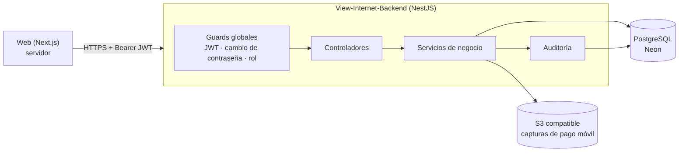

# Documentación de View Internet (API)

View Internet controla el pago mensual del internet de la sede de Informática. El sistema tiene dos partes:

| Repositorio | Qué hace |
| --- | --- |
| [View-Internet](https://github.com/Centro-De-Estudiantes-Informatica/View-Internet) | App web en Next.js: muestra datos y envía acciones. |
| **View-Internet-Backend** (este) | API REST en NestJS: guarda los datos y aplica **todas** las reglas de negocio y de permisos. |

La API no la llama el navegador directamente: la web la consume desde su servidor (patrón *Backend for Frontend*). Aun así, la API **no confía en la web**: valida cada petición, cada rol y cada dato.

## Qué resuelve

- **Personas y roles**: el administrador crea las cuentas (cédula + contraseña temporal); hay dos roles, `ADMIN` y `ESTUDIANTE`, y siempre debe quedar un administrador activo.
- **Cuota mensual en USD**, congelada por mes.
- **Pagos en tres monedas** (USD, bolívares y pesos colombianos), convertidos a USD con la tasa del día, que queda guardada en el pago.
- **Pago móvil**: lo reporta el estudiante con su referencia y captura; un administrador lo aprueba o lo rechaza.
- **Estado de cada estudiante** por mes (al día, parcial, en revisión, pendiente), calculado a partir de los pagos.
- **Métricas** para el panel: recaudado por moneda, esperado, estudiantes al día y serie mensual.
- **Auditoría**: cada cambio queda registrado con quién y cuándo. Los pagos nunca se borran.

## Documentos

| Documento | Para qué sirve |
| --- | --- |
| [Arquitectura](arquitectura.md) | Módulos, ciclo de una petición, autenticación, almacenamiento y auditoría |
| [Modelo de datos](modelo-de-datos.md) | Tablas, relaciones e índices |
| [Reglas de negocio](reglas-de-negocio.md) | Cédulas, periodos, tasas, conversión, estados de pagos y de estudiantes, roles |
| [API](api.md) | Endpoints por rol, convenciones y códigos de error |
| [Operación](operacion.md) | Desarrollo local, variables, migraciones, pruebas, CI y despliegue |

El contrato exacto (esquemas y ejemplos) está en `openapi.json` y en Swagger UI (`/docs`) con el servidor en marcha.
