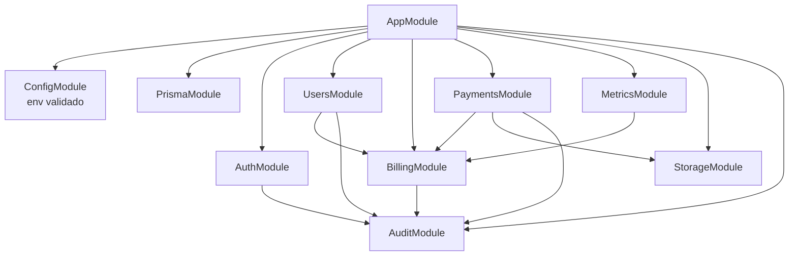
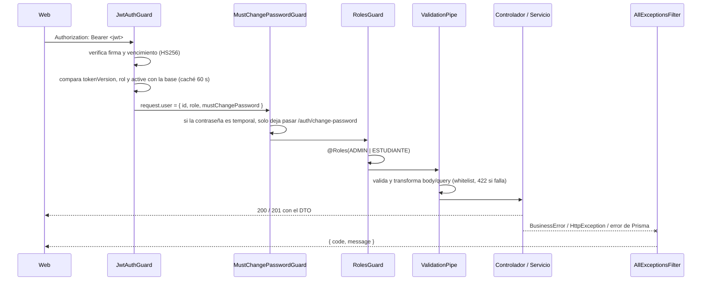

# Arquitectura de la API

## Stack

| Pieza | Uso |
| --- | --- |
| NestJS 11 (Express) | Módulos, controladores, guards, pipes |
| Prisma 6 | Acceso a datos y migraciones |
| PostgreSQL (Neon en producción) | Base de datos, con las extensiones `unaccent` y `pg_trgm` |
| class-validator / class-transformer | Validación de cada body y query |
| @nestjs/jwt + bcryptjs | Tokens de acceso y hash de contraseñas |
| @nestjs/throttler | Límite de peticiones por IP en el login |
| AWS SDK v3 (S3) | Capturas de pago móvil en almacenamiento compatible con S3 (R2, MinIO…) |
| @nestjs/swagger | OpenAPI en `/docs` y `openapi.json` |
| zod | Validación de variables de entorno al arrancar |
| Jest + Supertest | Pruebas unitarias y e2e |

## Módulos

| Carpeta | Responsabilidad |
| --- | --- |
| `src/auth/` | Login, cambio de contraseña, emisión de JWT, guards globales, límite de intentos |
| `src/users/` | Alta, listado y búsqueda, cambio de rol, activar/desactivar, restablecer contraseña |
| `src/billing/` | Cuota mensual (`settings`), periodos, tasas de cambio, cuota en cada moneda |
| `src/payments/` | Pagos en efectivo, pago móvil, revisión, anulación, estado del estudiante |
| `src/metrics/` | Resumen del periodo, serie mensual, últimos pagos |
| `src/storage/` | Subida y URLs firmadas de capturas (S3) y detección del tipo de imagen |
| `src/audit/` | Registro de auditoría dentro de la misma transacción del cambio |
| `src/common/domain/` | Reglas puras y probadas sin base de datos: cédulas, dinero, periodos, estado mensual, texto |
| `src/common/errors/` | `BusinessError` y el filtro que normaliza todos los errores a `{ code, message }` |
| `src/config/` | Esquema de variables de entorno y servicio tipado `AppConfig` |

## Ciclo de una petición

- Los tres guards son **globales**. Las rutas abiertas se marcan con `@Public()` (solo `POST /auth/login` y `GET /health`) y el cambio de contraseña con `@AllowPendingPasswordChange()`.
- `ValidationPipe` usa `whitelist` y `forbidNonWhitelisted`: un campo desconocido es un error 422, no se ignora.
- `AllExceptionsFilter` convierte todo error en `{ code, message }` (más `details` en errores de validación). Los errores de Prisma `P2002` (único) y `P2025` (no existe) se traducen a 409 y 404.

## Autenticación

### Login

1. `POST /auth/login` recibe la cédula en cualquier formato y la normaliza (`parseCedula`). Sin prefijo, busca solo por dígitos; si hay una cuenta `V` y otra `E` con los mismos dígitos, no adivina y falla.
2. Compara la contraseña con bcrypt. Si la cédula no existe, compara contra un hash ficticio para que la respuesta tarde lo mismo y no revele qué cédulas existen.
3. Cualquier fallo responde `401 INVALID_CREDENTIALS` con el mismo mensaje.
4. Emite un JWT HS256 con `{ sub, role, tv }` (`tv` = `tokenVersion`), válido `JWT_EXPIRES_IN_SECONDS` (8 h por defecto).

### Cómo se invalidan los tokens

Cada usuario tiene un `tokenVersion`. Cambiar o restablecer la contraseña lo incrementa, y el guard rechaza cualquier token con una versión anterior (`401`). El rol y el estado `active` también se leen de la base en cada petición, no del token: quitar un rol o desactivar una cuenta tiene efecto de inmediato.

Para no consultar la base en cada petición, `AuthStateService` guarda ese estado en memoria por `AUTH_CACHE_TTL_MS` (60 s). Los cambios en la misma instancia la invalidan al instante; otras instancias los ven al vencer la caché.

### Límites de intentos

| Límite | Dónde | Por defecto |
| --- | --- | --- |
| Por cédula | `LoginAttemptsService` (en memoria) | 5 fallos en 15 min → `429 TOO_MANY_ATTEMPTS` |
| Por IP | `ThrottlerGuard` en `/auth/login` | `LOGIN_IP_LIMIT` (30) peticiones en `LOGIN_WINDOW_MS` (15 min) |

Ambos viven en memoria: con varias instancias aplican por instancia. Como la web llama desde su servidor, reenvía la IP del navegador en `X-Forwarded-For`; para usarla, `TRUST_PROXY` debe indicar cuántos saltos de proxy son de confianza.

## Almacenamiento de capturas

- El pago móvil acepta una imagen opcional en el campo `receipt` (multipart), de máximo 5 MB.
- El tipo se detecta por los *magic bytes*, no por la extensión ni el `Content-Type`: solo JPG y PNG.
- Se guarda en el bucket privado como `receipts/<userId>/<uuid>.<ext>`. Si la transacción del pago falla después, la captura se borra para no dejar archivos huérfanos.
- Solo un `ADMIN` puede verla, mediante una URL firmada que vence en 5 minutos (`GET /payments/{id}/receipt`).
- Sin las variables `S3_*`, subir o ver capturas responde `STORAGE_NOT_CONFIGURED`; el resto de la API funciona.

## Auditoría

`AuditService.log()` escribe en `audit_logs` **dentro de la misma transacción** que el cambio: si el cambio falla, no queda registro, y viceversa. Cada registro guarda quién (`actorId`), qué (`action`, `entity`, `entityId`) y el antes/después en JSON.

| Acción | Cuándo |
| --- | --- |
| `USER_CREATED`, `USER_UPDATED`, `USER_ACTIVATED`, `USER_DEACTIVATED` | Alta y cambios de una persona |
| `ROLE_CHANGED` | Cambio de rol |
| `PASSWORD_RESET` | Un administrador restablece una contraseña |
| `FEE_UPDATED` | Cambio de la cuota mensual |
| `RATE_CREATED`, `RATE_UPDATED` | Registro o corrección de una tasa |
| `PAYMENT_CASH_REGISTERED`, `PAYMENT_MOBILE_REPORTED` | Alta de un pago |
| `PAYMENT_APPROVED`, `PAYMENT_REJECTED`, `PAYMENT_VOIDED` | Revisión y anulación |

## Concurrencia

| Situación | Cómo se resuelve |
| --- | --- |
| Dos administradores aprueban el mismo pago | `UPDATE … WHERE id = ? AND status = 'EN_REVISION'`; si no afecta filas, `409 INVALID_PAYMENT_STATE` |
| Quitar el rol o desactivar a dos administradores a la vez | `SELECT … FOR UPDATE` sobre los administradores activos antes de contar (`LAST_ADMIN`) |
| Dos reportes con la misma referencia al mismo tiempo | Índice único parcial `(bank, reference)` → `409 DUPLICATE_REFERENCE` |
| Dos peticiones abren el mismo periodo | `upsert` del periodo |

## Fechas y zona horaria

"Hoy" y el "periodo actual" se calculan en `APP_TIMEZONE` (`America/Caracas`), no en UTC: un pago a las 10 p. m. del 31 de octubre en Venezuela pertenece a octubre aunque en UTC ya sea noviembre. Las fechas sin hora (`paidAt`, `effectiveDate`) se guardan como `DATE`.
