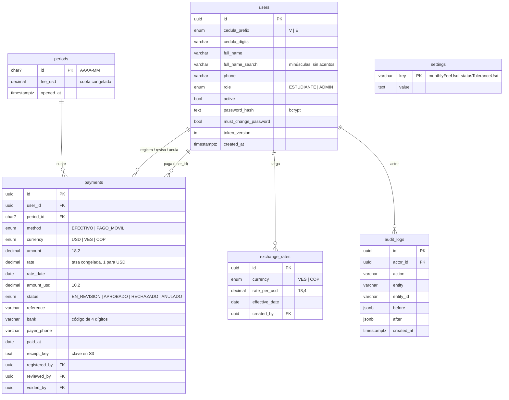

# Modelo de datos

Fuente de verdad: `prisma/schema.prisma` y el SQL de `prisma/migrations/`.

## Tablas

### `users`

Personas del sistema, estudiantes y administradores.

- La cédula se guarda partida en `cedula_prefix` (`V`/`E`) y `cedula_digits` (sin ceros a la izquierda). La unicidad es por el par. Se muestra como `V-28.123.456`.
- `full_name_search` es el nombre en minúsculas y sin acentos, para buscar "jose" y encontrar "José".
- `token_version` se incrementa al cambiar o restablecer la contraseña e invalida los tokens anteriores.
- `must_change_password` es `true` al crear la cuenta o restablecer la contraseña.
- Nunca se borran: se desactivan (`active = false`) y conservan su historial.

Índices: único `(cedula_prefix, cedula_digits)`; índices trigram (GIN, `pg_trgm`) sobre `cedula_digits` y `full_name_search` para las búsquedas parciales; `(role, active)`.

### `settings`

Configuración clave-valor:

| Clave | Valor |
| --- | --- |
| `monthlyFeeUsd` | Cuota mensual vigente en USD, p. ej. `5.00` |
| `statusToleranceUsd` | Tolerancia para considerar a alguien al día (por defecto `0.05` si no existe) |

### `periods`

Un registro por mes (`2026-10`). Se crea **de forma perezosa** la primera vez que se necesita (un pago, una consulta de estado) y **congela** la cuota vigente en ese momento en `fee_usd`. Así, cambiar la cuota no altera los meses ya abiertos.

### `exchange_rates`

Tasas de cambio: cuántas unidades de la moneda vale 1 USD. Una por moneda y día (único `(currency, effective_date)`); registrar otra para el mismo día la corrige. USD no tiene tasa: siempre es 1.

### `payments`

Cada pago pertenece a una persona y cubre **un** periodo. Guarda el monto original, la tasa usada (`rate`, `rate_date`) y el equivalente en USD (`amount_usd`) ya calculado: la tasa queda congelada en el pago.

| Campo | Efectivo | Pago móvil |
| --- | --- | --- |
| `currency` | USD, VES o COP | Siempre VES |
| `status` inicial | `APROBADO` | `EN_REVISION` |
| `registered_by` | El administrador | El propio estudiante |
| `reference`, `bank`, `payer_phone` | — | Obligatorios |
| `receipt_key` | — | Si adjuntó captura |
| `reviewed_by`, `reviewed_at`, `review_note` | — | Al aprobar o rechazar (el motivo del rechazo va en `review_note`) |
| `voided_by`, `voided_at`, `void_reason` | Al anular | Al anular |

Índices: `(period_id, status)` para las métricas, `(user_id, period_id)` para el estado de cada persona, `(status, created_at)` para la cola de revisión.

**Restricciones que solo existen en el SQL de la migración** (Prisma no las modela):

- Índice único parcial `(bank, reference) WHERE status IN ('EN_REVISION', 'APROBADO')`: la misma referencia no puede usarse dos veces, salvo que el pago anterior se haya rechazado o anulado.
- `CHECK`: monto y tasa positivos en `payments`, tasa positiva en `exchange_rates` y formato `AAAA-MM` del id de `periods`.

La coherencia entre método, moneda y campos (p. ej. pago móvil solo en VES) la aplica el servicio, no la base.

Si `prisma migrate dev` propone borrarlos en una migración nueva, hay que quitar esas líneas antes de aplicarla.

### `audit_logs`

Historial de cambios: quién (`actor_id`), qué acción, sobre qué entidad y el antes/después en JSON. Ver la lista de acciones en [arquitectura](arquitectura.md#auditoría).

## Tipos de datos

| Dato | Tipo en la base | En la API |
| --- | --- | --- |
| Montos | `DECIMAL(18,2)` / `DECIMAL(10,2)` | String con 2 decimales: `"1000.00"` |
| Tasas | `DECIMAL(18,4)` | String con 4 decimales: `"200.0000"` |
| Fechas sin hora | `DATE` | `"2026-10-26"` |
| Instantes | `TIMESTAMPTZ(3)` | ISO 8601 |
| Periodos | `CHAR(7)` | `"2026-10"` |

En el código, los montos son siempre `Prisma.Decimal`; nunca `number`, para no perder precisión.
