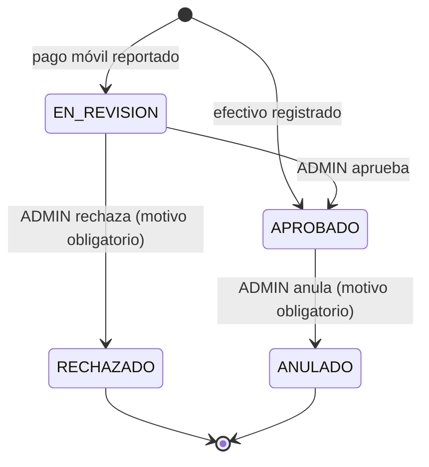

# Reglas de negocio

Todas estas reglas viven en la API. La web solo las muestra. Las reglas puras están en `src/common/domain/` y tienen pruebas unitarias.

## Personas y cédulas

- Las cuentas las crea un `ADMIN` (`POST /users`); no hay autorregistro.
- La cédula se acepta con o sin puntos, guiones, espacios o prefijo: `V-28.123.456`, `v28123456` y `28123456` son la misma. Sin prefijo se asume `V` al crear la cuenta.
- Debe tener entre 5 y 9 dígitos; se guardan sin ceros a la izquierda.
- No puede haber dos personas con el mismo prefijo y dígitos (`409 CEDULA_TAKEN`).
- Al crearla se genera una **contraseña temporal** de 10 caracteres (sin caracteres ambiguos como `0/O` o `1/l/I`), que se devuelve una sola vez. La persona debe cambiarla en su primer ingreso.

### Búsqueda

`GET /users?q=` busca por cédula o por nombre:

- Si el término tiene **3 o más dígitos**, compara contra los dígitos de la cédula (`28.123` encuentra `V-28.123.456`).
- Si no, compara contra el nombre sin mayúsculas ni acentos (`jose` encuentra `José Rodríguez`).

## Roles

| Rol | Puede |
| --- | --- |
| `ESTUDIANTE` | Ver su estado y su historial, reportar pagos móviles |
| `ADMIN` | Todo lo demás: personas, roles, pagos, revisión, cuota, tasas, métricas |

- Nadie puede cambiar su propio rol (`409 CANNOT_CHANGE_OWN_ROLE`) ni desactivar su propia cuenta (`409 CANNOT_DEACTIVATE_SELF`).
- Siempre debe quedar **al menos un administrador activo** (`409 LAST_ADMIN`), tanto al quitar un rol como al desactivar una cuenta.
- El rol se toma de la base en cada petición: un cambio aplica de inmediato.
- Desactivar una cuenta impide iniciar sesión y la saca de lo "esperado" de los meses siguientes; su historial se conserva.

## Contraseñas

- Entre 8 y 72 caracteres (72 es el límite de bcrypt). La nueva debe ser distinta de la actual (`PASSWORD_REUSED`).
- Mientras `mustChangePassword` sea `true`, toda petición salvo `POST /auth/change-password` responde `403 PASSWORD_CHANGE_REQUIRED`.
- Cambiar o restablecer la contraseña cierra todas las sesiones abiertas de esa persona.
- 5 intentos fallidos en 15 minutos para la misma cédula bloquean el login de esa cédula por el resto de la ventana (`429 TOO_MANY_ATTEMPTS`).

## Periodos y cuota

- La cuota mensual se define en **USD** (`PUT /billing/fee`).
- Cada mes es un **periodo** `AAAA-MM`. Se abre la primera vez que se necesita y **congela** la cuota vigente en ese momento.
- Cambiar la cuota no afecta a los periodos ya abiertos. Al cambiarla, la API abre antes el mes en curso con la cuota anterior, así que la nueva aplica desde el mes siguiente. La respuesta indica ambas (`feeUsd` y `currentPeriodFeeUsd`).
- Sin cuota configurada, las operaciones que necesitan abrir un periodo responden `422 FEE_NOT_CONFIGURED`.
- El "periodo actual" y "hoy" se calculan en hora de Venezuela (`APP_TIMEZONE`).

## Tasas de cambio

- Una tasa por moneda (`VES`, `COP`) y día: cuántas unidades valen 1 USD. Registrar otra para el mismo día la corrige.
- La tasa que aplica a una fecha es **la última registrada en o antes de esa fecha**. Si no hay ninguna, `422 RATE_MISSING`.
- Una tasa se considera **desactualizada** (`stale: true`) si es anterior a ayer.
- `GET /billing/current` devuelve la cuota del mes en USD, VES y COP con la tasa vigente, para que el estudiante sepa cuánto pagar.

## Conversión de montos

```
amountUsd = amount ÷ ratePerUsd      (redondeo a 2 decimales, mitad hacia arriba)
monto en VES/COP = usd × ratePerUsd  (ídem)
```

- USD siempre usa tasa 1.
- La tasa se resuelve con la **fecha del pago** (`paidAt`) y queda **congelada** en el pago: si el bolívar cambia mañana, un pago de ayer sigue valiendo lo mismo en USD.
- Todo el cálculo usa `Decimal`; los montos viajan como strings (`"1000.00"`).

Ejemplo: cuota $5.00, tasa 200,00 Bs/USD → la cuota en bolívares es Bs 1.000,00. Un pago de Bs 1.000,00 equivale a $5.00.

## Pagos

### Tipos

| | Efectivo | Pago móvil |
| --- | --- | --- |
| Quién lo registra | `ADMIN` | El propio `ESTUDIANTE` |
| Moneda | USD, VES o COP | Solo VES (`MOBILE_PAYMENT_VES_ONLY`) |
| Estado inicial | `APROBADO` | `EN_REVISION` |
| Datos extra | Nota opcional | Referencia (4–20 dígitos), código del banco (4 dígitos), teléfono, captura opcional |

Reglas comunes:

- El monto debe ser mayor que cero, con hasta 2 decimales.
- La fecha del pago no puede ser futura (`DATE_IN_FUTURE`).
- Cada pago cubre **un** periodo. Se puede pagar un mes anterior o hasta **12 meses por adelantado** (`INVALID_PERIOD`).
- Si el pago móvil no indica periodo, se asigna al mes actual. (La web envía el mes adeudado más antiguo.)
- Una misma referencia en el mismo banco no puede repetirse entre pagos `EN_REVISION` o `APROBADO` (`409 DUPLICATE_REFERENCE`). Si el pago anterior se rechazó o anuló, la referencia vuelve a estar disponible.

### Ciclo de vida



- **Los pagos nunca se borran.** Un error se corrige anulando el pago con un motivo.
- Solo un pago `EN_REVISION` se puede aprobar o rechazar, y solo uno `APROBADO` se puede anular. Cualquier otra transición responde `409 INVALID_PAYMENT_STATE` (incluido el caso de dos administradores revisando el mismo pago a la vez).
- Solo los pagos `APROBADO` cuentan para el estado del estudiante y para las métricas.
- El motivo del rechazo o de la anulación tiene entre 3 y 500 caracteres, y el estudiante lo ve en su historial.

## Estado mensual de un estudiante

Se **calcula** en cada consulta a partir de los pagos; nunca se guarda ni se edita a mano.

```
pagado    = suma de amountUsd de los pagos APROBADO del periodo
tolerancia = $0.05 (setting statusToleranceUsd)

si pagado ≥ cuota − tolerancia        → AL_DIA
si no, si pagado > 0                  → PARCIAL
si no, si tiene pagos EN_REVISION     → EN_REVISION
si no                                 → PENDIENTE
```

- La tolerancia absorbe pequeñas diferencias de conversión: con cuota $5.00 y tasa 200, pagar Bs 990,00 ($4.95) cuenta como al día; Bs 980,00 ($4.90) queda parcial.
- Saldo pendiente = `max(0, cuota − pagado)`, y 0 si está al día.
- La misma regla está en TypeScript (`periodStatus()`) y en SQL (`userPeriodStatusSql()`, para los listados sin consultas N+1). Si se cambia una, hay que cambiar la otra.

### Qué meses debe

`GET /me/status` revisa los periodos abiertos desde el **mes de alta** de la persona (más cualquier periodo en el que tenga pagos) hasta el actual, y devuelve como adeudados los que no estén `AL_DIA`, con el total pendiente en USD, VES y COP a la tasa vigente.

## Métricas

`GET /metrics/summary?periodo=` (por defecto, el actual):

| Dato | Cálculo |
| --- | --- |
| Recaudado por moneda | Suma de `amount` y de `amountUsd` de los pagos `APROBADO` del periodo, por moneda |
| Total en USD | Suma de `amountUsd` de los pagos `APROBADO` |
| Esperado | Estudiantes activos (rol `ESTUDIANTE`, creados antes de que terminara el periodo) × cuota del periodo |
| % cobrado | Total ÷ esperado × 100 |
| Estudiantes por estado | Conteo de esos estudiantes según la regla del estado mensual |
| Por revisar | Pagos `EN_REVISION` del periodo y en total |

Los administradores no cuentan en lo esperado. `GET /metrics/monthly` devuelve el total en USD de los últimos N meses (6 por defecto, máximo 24), con 0 en los meses sin pagos. `GET /metrics/recent` devuelve los últimos pagos aprobados (10 por defecto, máximo 50).
